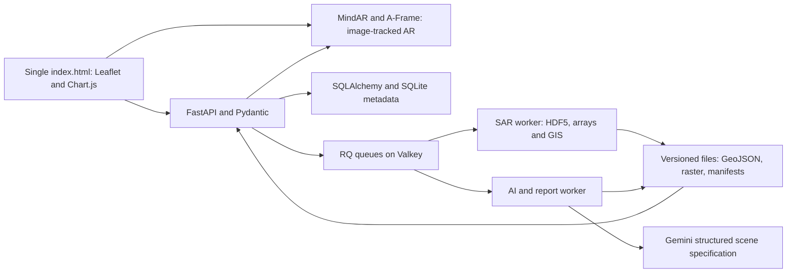

# RAÍZ-SAR AI technology stack

**Decision date:** November 14, 2026. **Status:** selected implementation baseline, not an installed or validated application. This resolves the owner's request for a defined stack. Change the baseline through an evidence-backed ADR rather than repeatedly reopening every tool choice.

## Selected architecture

A single HTML/JavaScript frontend consumes a Python API. SAR processing and AI/report generation run in separate job workers. All views share versioned evidence, planting-plan and scene contracts. Read [SAR foundations](SAR_FOUNDATIONS.md) before implementing the science path.

## Concrete components

| Layer | Selected component/version | Responsibility |
| --- | --- | --- |
| Python runtime | CPython **3.12.x**, Linux x86-64 | Scientific/API/worker baseline; the current desktop interpreter is 3.11.9 and is not the target runtime |
| API | FastAPI **0.163.0**, Uvicorn **0.54.0**, Pydantic **2.14.3** | Typed requests, validation, schema, job/status resources and same-origin frontend serving |
| Metadata | SQLAlchemy **2.1.8** with standard-library SQLite | Small single-host pilot metadata; geometry/rasters remain versioned artifacts |
| Queue | RQ **3.0.0**, redis-py **8.1.0**, Valkey **8.1.11** server | Separate bounded SAR and AI/report queues; no heavy work inside an HTTP request |
| ASF discovery | asf_search **14.1.0** | ASF catalog and product metadata/download interface |
| Earthdata access | earthaccess **0.19.0** | Earthdata authentication, CMR/ancillary discovery and authorized access |
| HDF5 | h5py **3.16.0** | GCOV dataset/metadata/window reading |
| Numerical work | NumPy **2.5.4**, SciPy **1.18.1** | Masked arrays, validated change metrics and limited filtering/statistics |
| Raster GIS | Rasterio **1.5.2**, its matched GDAL wheel | Transforms, reprojection, clipping, GeoTIFF/COG and quality masks |
| Vector GIS | GeoPandas **1.2.0**, Shapely **2.2.0**, pyproj **3.8.0** | Eligibility geometry, intersections and CRS conversion |
| AI service | Google Gen AI SDK **3.3.0**, default model **gemini-3.8-flash** | Actual server-side schema-constrained future-scene/report generation |
| HTTP client | HTTPX **0.28.1** | Bounded outbound/provider requests and API testing |
| Frontend | HTML5 and native JavaScript, one `index.html` entry point | No React/Next/Vue migration or production Node server for this prototype |
| Map | Leaflet **1.9.4** | Two-dimensional evidence, sector selection, plan and overlay display |
| Charts | Chart.js **4.6.1** | Explicit-unit observation/scenario charts |
| Styling | Tailwind **4.3.5** browser package for the demo | Source-requested CDN prototype; compile CSS for production |
| Icons | Lucide **1.73.0** | English-labeled controls with licensed SVG icons |
| AR | MindAR **1.2.5** with A-Frame **1.6.0** | Actual camera/image-target registration and interactive tabletop scene |
| Python QA | pytest **9.2.0**, Hypothesis **6.170.15** | Contract-derived property tests, API checks and replayable failures |
| Browser/JS QA | Node **22.x** tooling, Playwright **1.65.1**, fast-check **4.10.2** | Interaction/state properties and browser checks; no Node production runtime |

Exact direct Python pins are in [requirements.txt](../requirements.txt), QA additions in [requirements-dev.txt](../requirements-dev.txt), and the Linux-targeted transitive resolver snapshot in [requirements-linux-py312.lock](../requirements-linux-py312.lock). Frontend versions and evidence are recorded in [frontend-dependencies.json](../frontend-dependencies.json).

## Why Python 3.12

Current package metadata for NumPy, SciPy, Rasterio, pyproj and earthaccess requires Python 3.12. Keeping the desktop's 3.11 environment would force older releases and an unnecessary second compatibility matrix. Python 3.12 is selected instead of the newest language version to keep a common scientific-wheel target. No global interpreter/packages were upgraded.

Keep ArcGIS Pro's Python environment separate. Do not mix pip GDAL wheels with ArcGIS/Conda DLLs. [Rasterio's installation guidance](https://rasterio.readthedocs.io/en/stable/installation.html) explicitly cautions that wheels are not universally compatible with other binary environments/drivers. The default GCOV reader is h5py; do not assume Rasterio's wheel exposes every HDF5 driver. A single consistent Conda-forge environment is the documented fallback if actual native-library tests fail, requiring a new lock and ADR update.

## SAR path and outputs

Use preprocessed NISAR GCOV as the primary input family, not raw focusing/InSAR as a default. Inspect gamma0 power, actual channels, masks, coordinates, acquisition geometry and processing version. h5py extracts; NumPy/SciPy analyze; Rasterio georeferences and publishes; GeoPandas/Shapely/pyproj apply vector constraints. No direct conversion from SAR intensity to buried moisture depth or plant survival is assumed.

Publish small AOI GeoJSON, raster previews/COGs and a JSON manifest. The browser receives derived products, never entire HDF5 scenes. Use a selected band/date/quality layer with a source record. Initially serve precomputed image overlays and bounded GeoJSON; add a tile server only after measured viewport/payload limits justify it.

## Actual AR and AI construction

The primary AR mode is **image-tracked tabletop AR**, registered to a printed/displayed map target with a versioned AOI extent and declared tabletop scale. This is real camera registration, not a 3D orbit viewer and not survey-grade geolocation. The selected pair follows the [MindAR quick-start example](https://hiukim.github.io/mind-ar-js-doc/quick-start/overview/). Use A-Frame's bundled three.js through `AFRAME.THREE`; do not load another incompatible global three.js copy.

Declare Chrome on a desktop with webcam as the first verification target; test Android Chrome over an actually secure reachable origin next. Camera permission, correct target, tracking quality and scene interaction remain required acceptance checks. Keep a labeled camera-free 3D/2D preview for unsupported devices, without marking the AR requirement complete. MindAR does not require WebXR hit-test support for this image-tracking path. HTTPS or trustworthy localhost is required for camera access; another device's LAN HTTP address is not localhost.

The chosen AI path is **Gemini → structured `FutureSceneSpecification` → Pydantic and geometry validation → deterministic scene assembly → MindAR/A-Frame**. It constructs spatial vegetation scenarios; it does not train a moisture/survival model or generate a validated ecological forecast. Ground requests in allowed species, eligible polygons, terrain/reference frame, budget, establishment assumptions and plan version. Validate finite values, bounds, asset allowlists and evidence classes before rendering. Prefer procedural vegetation geometry initially; generative meshes/images are outside the critical path.

Configure `GEMINI_API_KEY` only on the backend and `GEMINI_MODEL=gemini-3.8-flash`. The model is documented with structured outputs by the provider; access/quota/retention terms and a real request still need account-specific verification. No free-tier, latency or spending guarantee is assumed. Report inference failures honestly; a fixture is not a successful actual-AI demonstration. Do not send full satellite rasters or credentials to the model.

## Jobs, persistence and concurrency

- Start one API process, one SAR worker and one AI/report worker. Each worker processes one job at a time. Separate queues prevent a large raster from blocking scene generation. Workers execute on Linux/WSL2/container runtime, not inside ArcGIS Pro.
- Use Valkey persistence and trusted private queue access. Restrict enqueued functions and use JSON serialization; API clients cannot submit callable names, pickle payloads or arbitrary URLs.
- A job submission returns `202` and an ID/status resource. Use bounded polling/backoff for the MVP; WebSockets/SSE are not required initially.
- Key jobs and artifacts by AOI/input IDs, algorithm/parameter versions, model/plan/schema versions and relevant asset versions. Deduplicate requests and atomically publish complete manifests; retries do not establish exactly-once execution.
- Use SQLite on a local single-host volume with WAL, foreign keys, short transactions and bounded busy timeout. No raster/AI work runs while holding a write transaction. SQLite and the queue are not a multi-host database solution.
- Bound AOI, feature/asset counts, input bytes, execution time, queue depth and retries. Respect provider throttling; retry transient failures with jitter and finite budgets. Preserve last valid results with their actual age/version.
- Graduate to PostgreSQL/PostGIS and object storage when multi-host writes/spatial SQL are needed, SQLite lock contention persists, or artifact sharing exceeds a single host. This is a defined evolution path, not an already deployed production stack.

## Delivery and environment

Keep frontend application code in `index.html`; backend modules, worker code, test harnesses, marker/terrain assets and data files are separate concerns. A single entry point is not an offline single-file scientific backend. Serve the page/API from the same origin during development. Use pinned CDN URLs for the demo; record fetched asset hashes before release. Tailwind's browser CDN is [development-only](https://tailwindcss.com/docs/installation/play-cdn); compile and embed/minify approved CSS before production delivery.

Use a Python 3.12 Linux environment for API/workers and a separate Valkey 8.1.11 process, coordinated through Docker Compose/WSL2 at implementation time. No Docker service or hosting account was installed/created here. Pin container patch versions/digests after target-image verification; this task does not invent an unverified image digest.

Prepare ignored local directories for original data, derived artifacts and logs; keep checksums, provenance and manifests. No hosted database, Kubernetes, vector database, LangChain, custom ML training or generative 3D service is required by this baseline.

## Verification actually completed

1. Read the supplied NASA SAR guide in a browser and inspected primary tool/product/runtime documentation.
2. Read official PyPI package metadata, including `Requires-Python`, versions and license fields. Read selected frontend official releases/metadata; a source-branch placeholder is not treated as a published version.
3. Ran pip **dry-run** resolution for CPython 3.12 / Linux x86-64 binary wheels with no package installation. It resolved 88 packages and returned wheel hashes. The generated lock is a **resolver snapshot**, not a security audit or runtime/ABI test. The resolver ran under Python 3.11 on Windows; environment-marker evaluation must be rechecked on the actual Linux/Python 3.12 target before treating it as a release lock.
4. Did not execute Python 3.12 imports, Docker/Valkey/RQ, a local NISAR pipeline, model inference or a camera/AR session. npm metadata requests from the shell timed out; frontend release evidence was verified through official source/release documentation instead. CDN delivery and a full npm/browser lock remain implementation acceptance checks.

The selected stack is concrete. Integration/scientific validity remains to be demonstrated rather than implied by dependency resolution.

## Implementation verification — November 14, 2026

The first implementation exercised the stack on the target runtime; details and gate status are in [IMPLEMENTATION_STATUS.md](IMPLEMENTATION_STATUS.md).

- **Runtime:** `python:3.12-slim-bookworm@sha256:935c3c5b…` (CPython 3.12.16). The [Dockerfile](../Dockerfile) installs from the lock with `--require-hashes`. All 19 direct imports succeed; Rasterio reports GDAL 3.12.2 with HDF5, COG and PNG drivers.
- **System dependency:** the Rasterio 1.5.2 manylinux wheel needs the system `libexpat1` on the slim image. This is an image detail, not a library change.
- **Lock:** regenerated inside the target image (86 packages). The earlier Windows-hosted snapshot included Windows-only `colorama`/`tzdata` and a different `cryptography` wheel.
- **Queue:** Valkey `8.1.11@sha256:8f836008…` with RQ 3.0.0; API, SAR worker and AI worker run as separate Compose services on port 8765 by default.
- **AI SDK:** google-genai 3.3.0 exposes `response_json_schema`, `seed` and `HttpOptions.timeout`, as used by the adapter. No actual inference yet (no key).
- **AR:** MindAR 1.2.5 compiled the target and tracked it with A-Frame 1.6.0 (`AFRAME.THREE`, no second three.js) through the camera pipeline using a recorded target video. Physical-device testing remains.
- **JS tooling:** `@playwright/test` 1.65.1 and fast-check 4.10.2 exist on the registry mirror (jsDelivr), but this network resets connections to registry.npmjs.org, so the local run used Playwright 1.64.1 and fast-check's jsDelivr ESM build. No stack change is implied.

No component was replaced, so ADR 0001 stands; its follow-up section records these checks.

## Required next implementation checks

Run target-environment lock regeneration and imports; a tiny synthetic HDF5 → masked array → georeferenced raster → polygon intersection test; a real local NISAR product inspection; worker restart/idempotency checks; one actual structured Gemini response; and one image-target AR session on declared hardware. Then run contract-based Hypothesis/fast-check campaigns and bounded malformed-GeoJSON/AI/scene fuzzing. Use independent references for science and do not count software tests as ecological validation.

See [ADR 0001](decisions/0001-technology-stack.md) for alternatives, trade-offs and review triggers.
